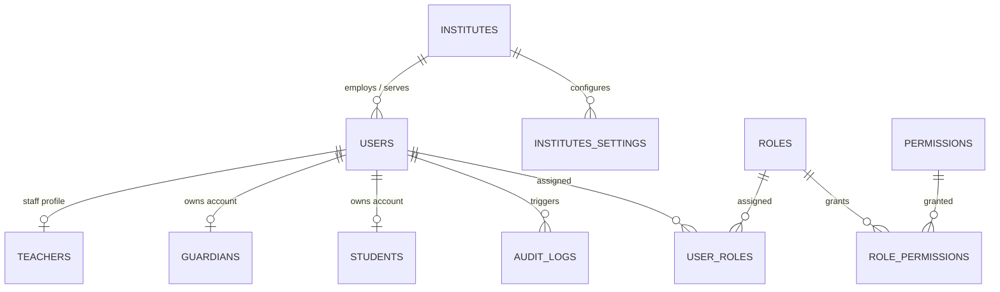
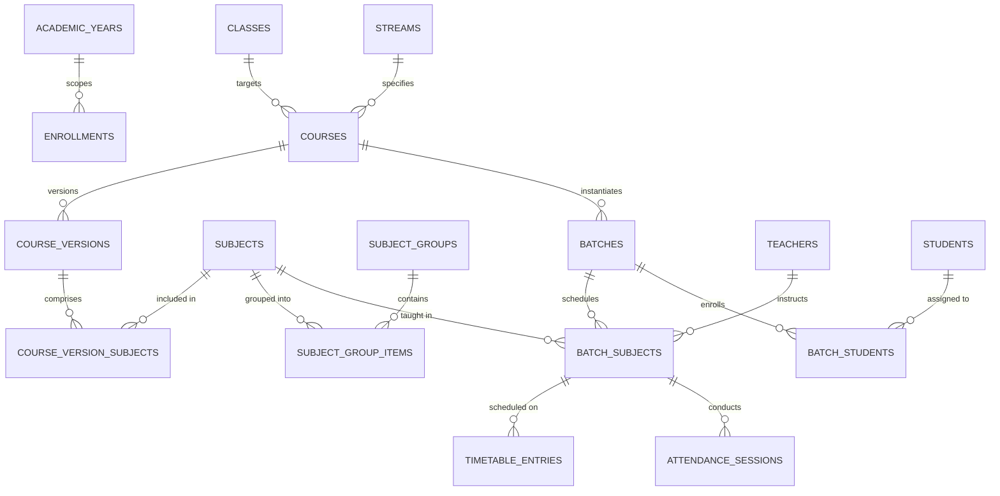
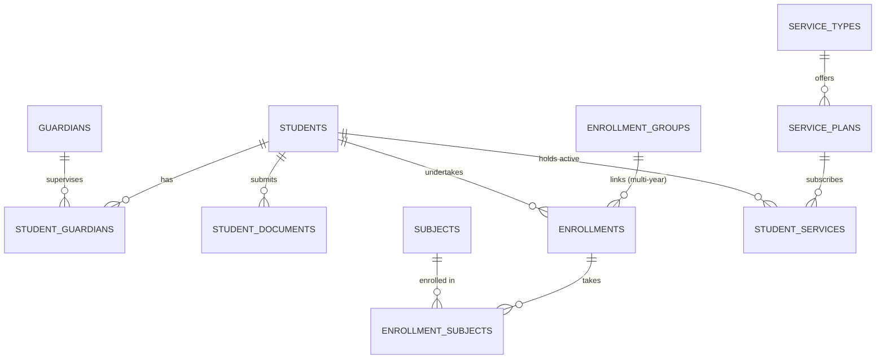
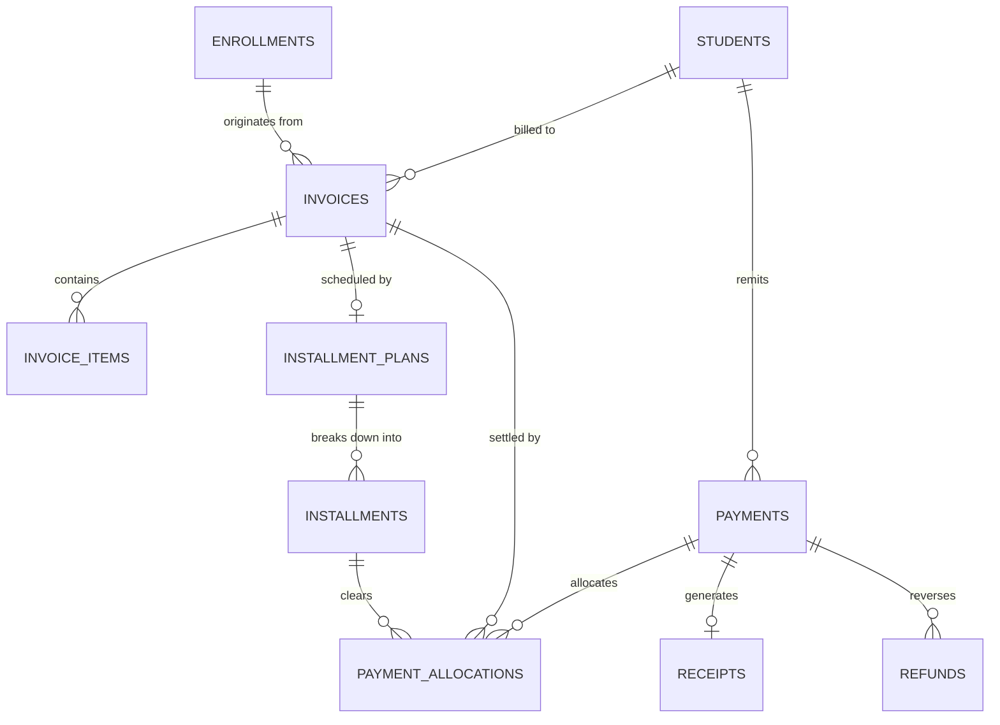
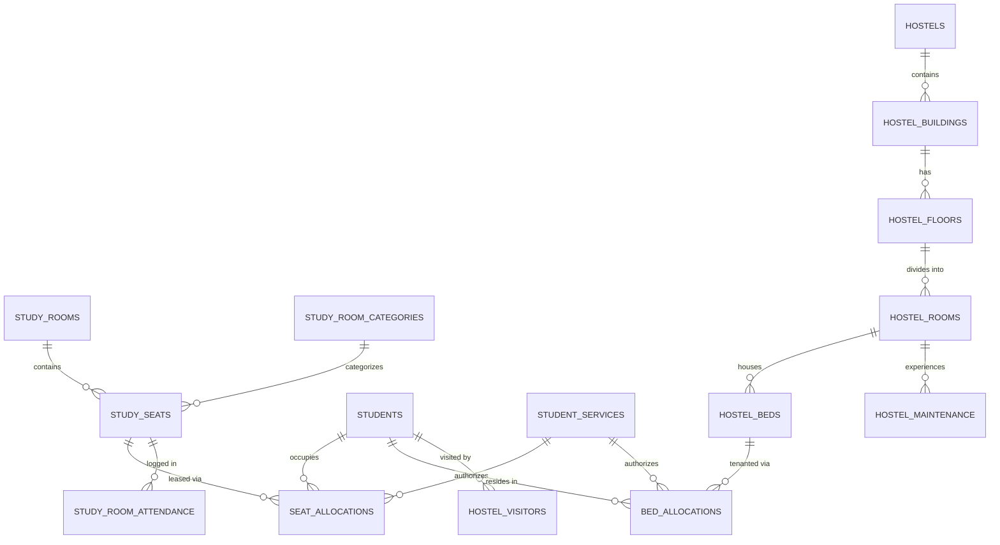
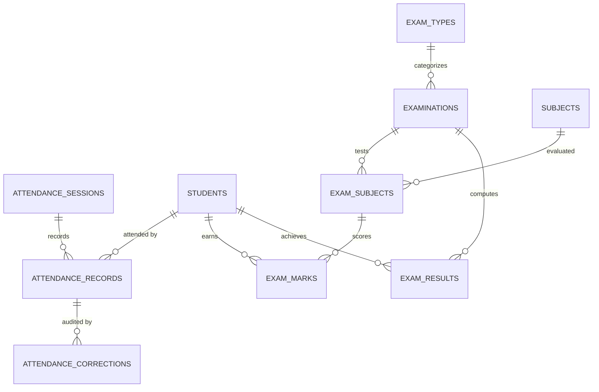

# Coaching Institute Management ERP - Entity Relationship Diagrams

## 1. Core Master Architecture & Security

---

## 2. Academic Curriculum, Batches & Timetable

---

## 3. Student Admissions, Enrollment & Services

---

## 4. Financial Engine: Invoices, Installments & Payments

---

## 5. Physical Facilities: Study Room (150 Seats) & Hostel

---

## 6. Attendance & Assessment Engine

